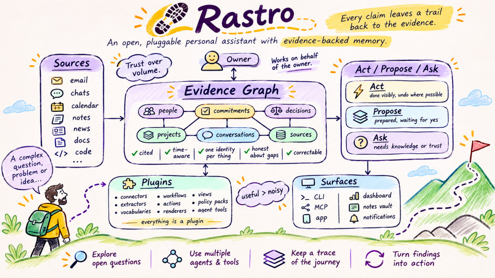
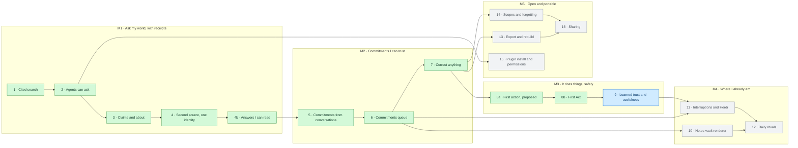

# Rastro

*The trail behind everything your assistant knows.*

Rastro is an open, pluggable personal assistant that keeps a cited understanding of your world and can propose or take actions on your behalf. Every claim leaves a trail back to its evidence.

## What works today

Rastro is **pre-alpha**. It can sync and search GitHub and Linear sources with citations and coverage, link identities, trace and correct claims, and extract meeting commitments for a terminal review queue.

An agent can propose a Linear issue; you can accept it from the CLI, inspect the run and undo it when safe. Rule-driven Act code supports grace windows, stopping pending runs, a daily cap and rechecking before execution. The 8a live switch day is unverified; the first live governed Act and installed minute scheduler are still ahead: slice 8b's T9 switch day has not happened. `rastro tick` can be run manually.

MCP exposes **ten read-only tools**: `search`, `coverage`, `about`, `why`, `commitments`, `meeting_commitments`, `focus`, `queue`, `actions` and `rules_check`. Writes stay on the CLI: for example, `queue accept`, `actions propose`, `actions stop`, `actions undo` and claim corrections. Rules are written in `config.toml` and inspected with `rastro rules check` or MCP `rules_check`.

There are no release binaries or installers, installed scheduler, or stranger-ready setup docs yet.

## Build from source

With the Rust toolchain specified in [rust-toolchain.toml](rust-toolchain.toml), from a checkout:

```sh
cargo build --locked --workspace
./target/debug/rastro --help
./target/debug/rastro mcp
```

The last command serves MCP over stdio; configure a client to launch it by absolute path. Sources and plugins require configuration before they can provide data. The CLI's `--help` describes its commands.

## Project documents

- [Delivery plan](docs/pm/gtm-plan.md) and [slice details](docs/roadmap.md)
- [Concept](docs/concept.md), [glossary](docs/GLOSSARY.md), [decisions](docs/decisions/) and [architecture decisions](docs/adr/)
- [Development](docs/development.md) and [open questions](docs/open-questions.md)

## Roadmap

Arrows mean "builds on". Green: done · amber: doing · blue: planning · grey: todo. Details and outcomes: `docs/roadmap.md`, which wins if this drawing disagrees.


