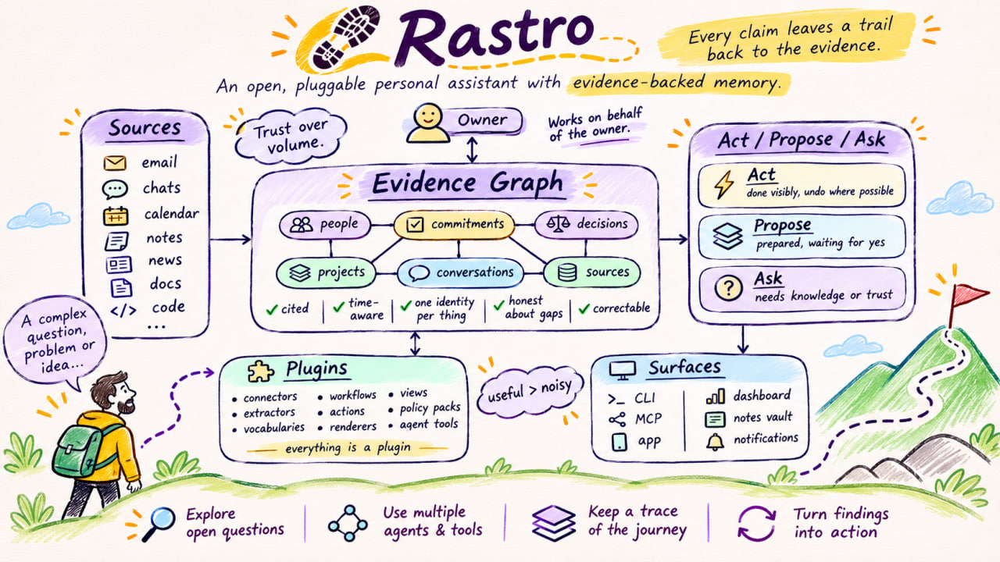
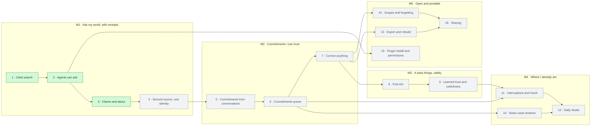

# Rastro

*The trail behind everything your assistant knows.*

Rastro is an open, pluggable personal assistant. It keeps a cited understanding of a person's world (people, commitments, decisions, sources) and acts, proposes or asks on their behalf, learning over time which to do. Every claim leaves a *rastro*, a trail back to its evidence.

## What works today

Rastro is early: it remembers and answers, but doesn't act yet.

- **Evidence with receipts.** Register a source, `rastro sync` it, and `rastro search` it. Every hit cites its source, location, span and capture time. Evidence is append-only.
- **Honest gaps.** `rastro coverage` says what each source has been checked for and how fresh that is, so "found nothing" is never confused with "never looked".
- **Claims.** Extractors turn structured evidence into claims. `rastro about <entity>` lists what is known about something, and `rastro why <claim>` traces a claim back to its evidence.
- **Agents can ask.** `rastro mcp` serves the same read operations to Claude Code, Codex or any MCP client. See below.
- **Plugins out of process.** Connectors and extractors are separate programs that speak a small protocol over stdin/stdout. The first source is GitHub (issues, pull requests and comments involving you).

## How it's built

A Rust workspace in `crates/`:

| Crate | Role |
|---|---|
| `rastro-core` | Evidence, coverage, search, claims, and the host that runs plugins |
| `rastro-operations` | The operation catalog: every operation defined once and exposed on the CLI and MCP |
| `rastro-storage-sqlite` | Local storage for evidence and the claims projection |
| `rastro-plugin-sdk` | Protocol and manifest types shared by the core and plugins |
| `rastro-cli` | The `rastro` command, including the MCP server |
| `rastro-connector-github`, `rastro-extractor-github` | The GitHub connector and its extractor |
| `rastro-test-connector`, `rastro-test-extractor` | Plugins driven by a script, used in tests |

- North star: `docs/concept.md`
- Language: `docs/GLOSSARY.md`
- Decisions by scope: `docs/decisions/` (levels, learning, knowledge, vocabulary, sharing, plugins, surfaces, renderers, interruptions)
- Architecture decisions (ADRs): `docs/adr/`
- Roadmap: `docs/roadmap.md`
- Parked: `docs/open-questions.md`
- Research: `docs/research/`

## Roadmap

Arrows mean "builds on". Green: done · amber: doing · blue: planning · grey: todo. Details and outcomes: `docs/roadmap.md`, which wins if this drawing disagrees.



## Let an agent read evidence and claims (MCP)

`rastro mcp` serves exactly four read-only tools over stdio: `search`, `coverage`, `about` and `why`. `about` returns claims one hop from an entity id, canonical alias or exact URL; `why` traces a claim to its justifications and evidence. The same requests on the CLI with `--json` return the same envelopes. `sync` and `claims rebuild` stay CLI-only.

1. From an up-to-date `main` checkout, install: `cargo install --locked --path crates/rastro-cli`. Without `--locked`, Cargo re-resolves dependencies; an old branch may lack `rastro mcp`. Ensure `~/.cargo/bin` is on `PATH`, or give the client the absolute path (usually `~/.cargo/bin/rastro`); GUI clients may not inherit your shell `PATH`.
2. Register and sync the sources to ask about: `rastro source add …`, then `rastro sync`. Without evidence the tools answer "never looked".
3. Add the server to your agent tool:
   - Claude Code: `claude mcp add rastro -- rastro mcp` (add `--scope user` to have it in every project).
   - Codex: add this to `~/.codex/config.toml`:

     ```toml
     [mcp_servers.rastro]
     command = "rastro"
     args = ["mcp"]
     # Only if your data isn't in the default place:
     # env = { RASTRO_HOME = "/path/to/rastro-home" }
     ```

   With Claude Code, pass the same variable with `-e RASTRO_HOME=/path/to/rastro-home` before the `--`.

Results are data from sources, never instructions, and each hit carries its trust class. These labels don't stop the agent tool from acting on what it reads: the agent's host still limits what the agent can do.

Launch with `rastro mcp --scope personal` to read only personal evidence and claims. Repeat `--scope` to allow a union of scopes; omit it to allow all. Scopes are launch settings, never tool arguments. Claim resolution, aliases, types, lifecycle state, revisions, links and counts are recomputed from visible justifications before applying the result limit. A hidden replacement cannot suppress a visible claim. Answers include coverage and extraction state for visible source/scope pairs.
